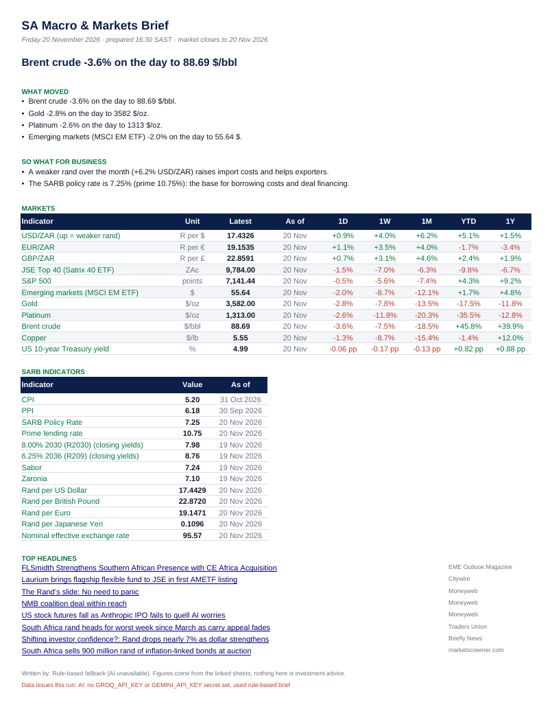
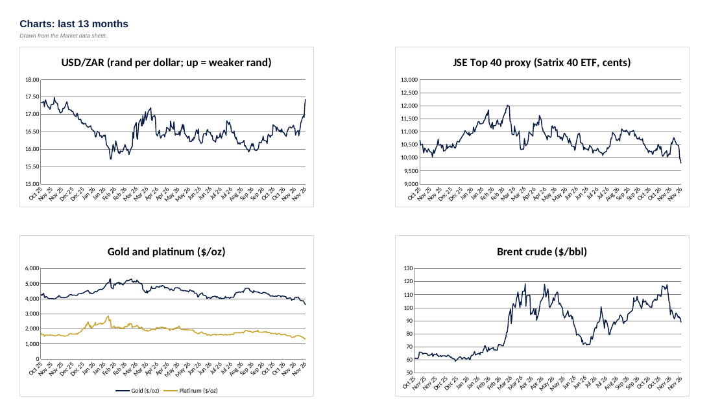

# SA Macro & Markets Brief 🇿🇦

**A Python pipeline that runs itself every weekday at 06:15 (SAST) on GitHub Actions. It pulls South African and global market data, Reserve Bank indicators and business headlines, has an AI analyst write a short "what moved / so what" brief, and saves a formatted Excel workbook with live formulas and charts.**

Python · pandas · openpyxl · GitHub Actions (free, scheduled) · Groq or Gemini (free AI tier) · no servers, no paid APIs

📥 **Latest workbook:** [`reports/latest.xlsx`](reports/latest.xlsx) · 📄 **Latest brief as text:** [`reports/latest.md`](reports/latest.md) · 🗂 **Archive:** [`reports/2026/`](reports/2026/)



---

## The problem
Strategy, M&A and finance teams start the day by checking the rand, the JSE, commodities, the SARB's rates and the news, across five or six sites. Each person does it by hand, the numbers end up in slides with no audit trail, and nobody keeps a history.

## What it does
```
Every weekday 06:15 SAST (GitHub Actions cron)
   │
   ├─ Yahoo Finance ── rand crosses, JSE Top 40 proxy, S&P 500, EM, gold, platinum, Brent, copper, US 10y
   ├─ ECB reference rates ── rand fallback if Yahoo fails
   ├─ SARB web API ── policy rate, prime, CPI, PPI, government bond yields, ZARONIA
   └─ News RSS ── SA economy and deals headlines from the last 36 hours, de-duplicated and tagged
   │
   ▼
Clean & compute ── drops bad price ticks; 1D / 1W / 1M / YTD / 1Y changes
   │
   ▼
AI analyst ── headline, what moved, so-what for business, what to watch (JSON, facts only)
   │            └─ rule-based fallback if the AI is unavailable
   ▼
Excel workbook ── committed to reports/, history appended to data/history.csv
                  (optional: emailed with the .xlsx attached)
```

## What's in the workbook
| Sheet | Contents |
|---|---|
| **Brief** | One-page summary: AI headline and bullets, markets table, SARB indicators, top headlines |
| **Charts** | 13-month line charts: USD/ZAR, JSE Top 40 proxy, gold and platinum, Brent |
| **Changes** | Reference values and dates for each period, with the change **formulas** (audit trail) |
| **Market data** | Daily closes for every series |
| **SARB** | Reserve Bank indicators with series codes and dates |
| **News** | Headlines with source, time, link and topic tags (rates, rand, fiscal, energy, mining, deals, trade) |
| **History** | One row per run, built up over time for trend analysis |
| **About** | Sources, method, colour code, disclaimer |

Built like an analyst's model: blue = source data, black = formulas, green = cross-sheet links; changes go green or red automatically. Every figure on the front page traces back to a source cell.



## Design decisions
- **Rules and code do the maths, AI does the words.** The AI only sees numbers the code has already computed and is told never to invent figures. If it fails, a rule-based brief still goes out.
- **No silent failures.** Each source is retried and wrapped separately. Anything that fails is listed under "Data issues this run" at the bottom of the brief, and the run only stops if there is no market data at all.
- **Free data is messy.** Free price feeds sometimes contain a one-day zero or spike, so the pipeline removes ticks that jump more than 25% and reverse the next day, and it logs how many it removed.
- **Zero cost, zero servers.** GitHub Actions is free for public repos, every data source is key-less, and the AI uses a free tier with one call a day.
- **History compounds.** Each run appends to `data/history.csv`, so the brief builds its own dataset over time.

## Run it yourself
1. Fork this repo.
2. Get a free key from [console.groq.com](https://console.groq.com) (or a Gemini key from Google AI Studio).
3. In **Settings → Secrets and variables → Actions**, add `GROQ_API_KEY` (or `GEMINI_API_KEY`).
4. Optional email delivery: add `GMAIL_USER`, `GMAIL_APP_PASSWORD` (a Google app password) and `BRIEF_TO`.
5. **Actions → SA Macro & Markets Brief → Run workflow**, or wait for 06:15 on the next weekday.

Locally: `pip install -r requirements.txt`, then `python -m brief.main --offline` to test with synthetic data, or `python -m brief.main` for live data.

## Re-target it for a client
Everything lives in [`brief/config.py`](brief/config.py): the tickers, news queries and topic tags. A mining client could add PGM miners and the iron ore price; a retailer could add consumer names and fuel; a deal team could track a list of targets. It takes about ten minutes, without touching the pipeline.

## Files
| Path | What |
|---|---|
| `brief/fetch.py` | Data collection with retries and bad-tick cleaning |
| `brief/analyse.py` | Snapshot, change maths, history |
| `brief/ai.py` | AI analyst prompt, provider choice, rule-based fallback |
| `brief/excel.py` | Workbook builder (openpyxl) |
| `brief/main.py` | Orchestration, Markdown brief, optional email |
| `.github/workflows/brief.yml` | Weekday schedule and commit-back |

---
For information only; not investment advice. Data: Yahoo Finance, European Central Bank, South African Reserve Bank, publishers' RSS feeds.

Built by **Sihlangu Mthembu** · Agentic workflows & automation · MIT licence
